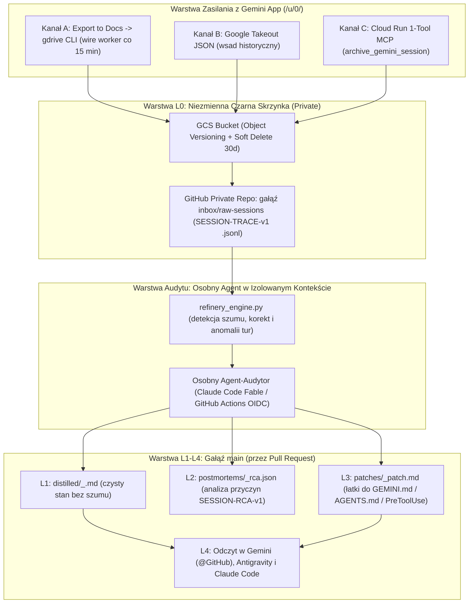

# Gotowa Architektura Wdrożeniowa: „Trajectory Refinery” (`v8.3.0`)

**Repozytorium referencyjne (Zero-PII):** `https://github.com/harmonic-ops-machine/lifeops-multi-agent-sim`  
**Docelowe prywatne repozytorium operacyjne:** `harmonic-ops-machine/gemini-session-refinery` (`private: true`)  
**Docelowy magazyn obiektowy (`Bronze`):** Google Cloud Storage (`gs://<ENCLAVE_BUCKET>-session-refinery`, `Object Versioning = ON`, `public_access_prevention = enforced`)

---

## 1. Przegląd Architektury i Przepływ Danych (`L0` → `L4`)

Architektura rozwiązuje jednocześnie trzy problemy pracy w **Gemini App**:
1. Wbudowany konektor `@GitHub` w Gemini App jest wyłącznie **do odczytu** (`read-only`).
2. Surowe rozmowy (szczególnie głosowe) zawierają szum komunikacyjny, pomyłki ASR oraz ślepe uliczki, które zatruwają kontekst kolejnych agentów (`context rot`).
3. Samo streszczenie końcowe wymazuje ślad błędów, uniemożliwiając osobnemu agentowi sprawdzenie **skąd wziął się błąd i jak najlepiej zabezpieczyć system przed jego powtórzeniem**.



---

## 2. Dwu-repozytoryjny Model Bezpieczeństwa (`Zero-PII` vs `Private Vault`)

| Repozytorium | Widoczność | Zawartość | Kto ma dostęp |
| :--- | :---: | :--- | :--- |
| **`harmonic-ops-machine/lifeops-multi-agent-sim`** *(niniejsze repo)* | `Public` | Kod silnika rafinerii (`src/`), schematy JSON (`schemas/`), skrypty IaC (`scripts/`), testy CI (`tests/`) oraz zanonimizowany audyt konfiguracji (`inventory/`). **100% Zero-PII.** | Publiczny odczyt + automatyczne CI `verify-zero-pii.yml`. |
| **`harmonic-ops-machine/gemini-session-refinery`** | `Private` | Rzeczywiste sesje robocze z Gemini App: gałąź `inbox/raw-sessions` (wskaźniki do `gs://` + zapis tur) oraz gałąź `main` (`distilled/`, `postmortems/`, `patches/`). | Wyłącznie klucz SSH `HIGHRES-enclave`, OIDC GitHub Actions oraz autoryzowany konektor `@GitHub` na koncie głównym. |

---

## 3. Trzy Komplementarne Kanały Zasilania (`Ingest`)

1. **Kanał A — Natychmiastowy bez usług chmurowych (`Export to Docs` → `gdrive` CLI):**
   - W Gemini App klikasz `Export to Docs` po zakończeniu pracy w wątku.
   - Lokalny worker (`wire_worker.py` wyzwalany co 15 min) odpytuje API Google Drive (`gdrive readonly recent`), pobiera nowe eksporty Markdown, normalizuje je przez `src/refinery_engine.py` do `SESSION-TRACE-v1`, archiwizuje oryginał w `gs://` i wypycha `.jsonl` na gałąź `inbox/raw-sessions`.
2. **Kanał B — Wsad historyczny (`Google Takeout JSON`):**
   - Jednorazowy eksport `Moja aktywność -> Aplikacje z Gemini (JSON)` wrzucony do bucketa `GCS` jest parsowany hurtowo przez `src/refinery_engine.py`, odtwarzając pełną historię dotychczasowych sesji roboczych.
3. **Kanał C — Bezpośredni zapis z czatu Gemini App (`src/cloudrun_mcp_ingestor.py`):**
   - Bezstanowy kontener Python 3.12 na **Google Cloud Run** eksponujący **dokładnie jedno narzędzie MCP** (`archive_gemini_session`), wolny od błędu limitu 485 narzędzi znanego ze Spacefast (`batchexecute` RPC `13`).
   - Zapisuje surowy przebieg sesji bezpośrednio do `GCS` oraz commituje plik `.jsonl` na gałąź `inbox/raw-sessions` przez krótkotrwały token GitHub App z Google Secret Managera.

---

## 4. Algorytm Osobnego Agenta-Audytora (`src/refinery_engine.py`)

Osobny agent nigdy nie działa wewnątrz tej samej sesji konwersacyjnej, którą ocenia. Otrzymuje surowy strumień `SESSION-TRACE-v1` i wykonuje 3 deterministyczne kroki:

1. **Klasyfikacja sygnału vs. szumu (`L1`):**
   - Oznacza i odcina tury puste, powitania, komunikaty techniczne podtrzymania połączenia, urwane duplikaty dyktowania oraz odrzucone warianty pośrednie.
   - Kompiluje zwięzły dokument `distilled/<date>_<session_id>.md` zawierający wyłącznie wiążące ustalenia, artefakty i otwarte decyzje.
2. **Detekcja i klasyfikacja błędów (`L2` — `SESSION-RCA-v1`):**
   - Wykrywa punkty tarcia (korekty użytkownika typu *„nie o to chodziło”*, przekłamania ASR, błędy uprawnień/narzędzi, przedwczesne deklaracje wykonania zadania).
   - Dla każdego incydentu zapisuje w `postmortems/<session_id>_rca.json`: indeks tury, kategorię przyczyny źródłowej (`ASR_VOICE_MISRECOGNITION`, `MISSING_CONTEXT_OR_MEMORY`, `TOOL_OR_CONNECTOR_LIMITATION`, `INSTRUCTION_DRIFT_OR_AMBIGUITY`, `API_OR_PERMISSION_FAILURE`, `PREMATURE_COMPLETION_CLAIM`, `ENVIRONMENT_CONFIG_MISMATCH`), mechanizm powstania błędu oraz optymalne rozwiązanie.
3. **Generowanie łatki ochronnej (`L3`):**
   - Tworzy propozycję zmiany w `patches/<session_id>_patch.md` wskazującą dokładny plik docelowy (`GEMINI.md`, `AGENTS.md`, `/u/0/saved-info` lub `pretool_single_hub_guard.py`) i otwiera Pull Request do gałęzi `main`.

---

## 5. Instrukcja Uruchomienia i Weryfikacji Pakietu

```bash
# 1. Uruchomienie pełnego zestawu testów jednostkowych i integracyjnych rafinerii
python architecture/trajectory-refinery/tests/test_refinery_pipeline.py

# 2. Podgląd (Dry-Run) aprowizacji bucketa GCS + bezkluczowego OIDC dla GitHub Actions
pwsh -NoProfile -File architecture/trajectory-refinery/scripts/provision_gcs_and_oidc.ps1 -ProjectId "<GCP_PROJECT_ID>" -BucketName "<BUCKET_NAME>"

# 3. Uruchomienie globalnego weryfikatora Zero-PII i spójności grafu repozytorium
python verify.py
```

---

## 6. Struktura Plików Modułu

- `ARCHITECTURE_PL.md` — niniejsza specyfikacja architektoniczna i operacyjna.
- `schemas/session_trace.schema.json` — formalny schemat JSON zapisu czarnej skrzynki (`SESSION-TRACE-v1`).
- `schemas/session_rca.schema.json` — formalny schemat JSON raportu przyczyn błędów i łatek (`SESSION-RCA-v1`).
- `src/refinery_engine.py` — referencyjny silnik normalizacji, filtracji szumu, detekcji błędów i generowania artefaktów PR.
- `src/cloudrun_mcp_ingestor.py` — 1-narzędziowy serwer HTTP MCP (`archive_gemini_session`) pod Cloud Run.
- `scripts/provision_gcs_and_oidc.ps1` — skrypt aprowizacji GCS (`Versioning` + `Soft Delete`) oraz federacji OIDC dla `harmonic-ops-machine` (domyślnie `DryRun`).
- `tests/test_refinery_pipeline.py` — automatyczne testy end-to-end wykonywane w GitHub Actions CI.
